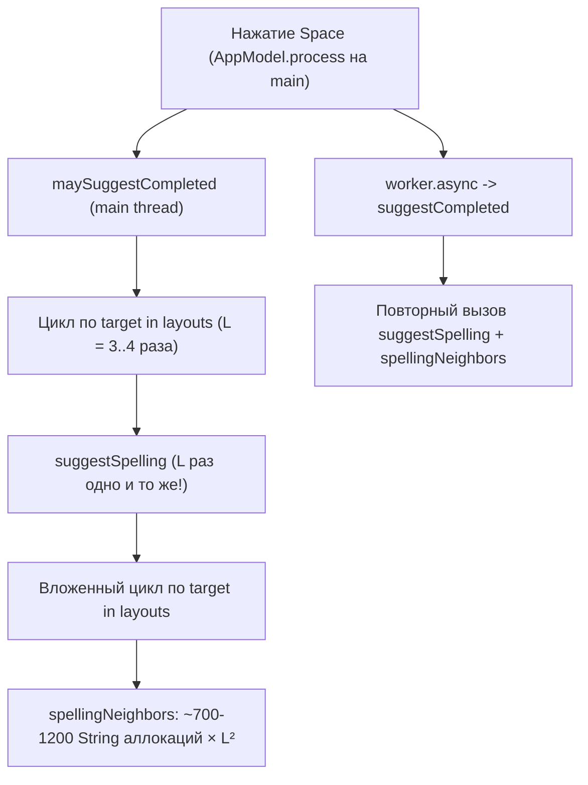

# Глубокий технический аудит проекта «Ясно» (Yasno v0.2.1)

**Дата проведения аудита:** 18 октября 2026 г.  
**Версия проекта:** `0.2.1` (`tech.yasno.app`)  
**Объект аудита:** Нативное macOS-приложение (`SwitchApp`), вычислительное ядро (`SwitchCore`), стенд валидации (`SwitchValidation` / `ValidationRunner`) и набор модульных/стресс-тестов (`SwitchCoreTests`, `SwitchAppTests`, `SwitchValidationTests`).  
**Фокус аудита:** Работоспособность (надёжность перехвата/повтора событий, многопоточность, безопасность редактирования текста через Accessibility API, полнота словарей) и оптимизация (алгоритмическая сложность на каждый символ, аллокации памяти, время холодного старта, потребление ОЗУ).

---

## 1. Резюме аудита (Executive Summary)

По сравнению с ранней ревизией (`v0.1.3`), в версии **`v0.2.1`** была проделана колоссальная инженерная работа:
1. **Выделенный поток перехвата событий (`local.yasno.event-tap`):** `CGEventTap` вынесен из главного UI-потока в отдельный поток с `QoS = .userInteractive`, а медленные вызовы (`AXUIElement`, `TISInputSource`, анализ текста) вынесены из callback'а перехватчика.
2. **Транзакционная замена текста без Backspace-спама и без буфера обмена (`AccessibleEditor` + `ReplacementTransaction`):** Вместо слепой генерации десятков `Backspace` и чтения всего документа целиком внедрена проверка границ, чтение локального диапазона через `kAXStringForRangeParameterizedAttribute` и пошаговая верификация выделения (`kAXSelectedTextRangeAttribute`) и результата вставки.
3. **Отказ от жёстко зашитых таблиц раскладок:** `KeyboardLayout` теперь динамически строит таблицы прямого и обратного отображения клавиш через системный `UCKeyTranslate` для реального типа клавиатуры (`LMGetKbdType()`).
4. **Защита сложных токенов и контекста:** Добавлено распознавание доменных имён и URL по списку IANA TLD (`WebAddress`), фильтрация составных латинских слов (`isCommonLatinCompound`), учёт контекста предложения (`contextPreference`), очистка русских/украинских частотных словарей от мусора субтитров через `ru-native.txt` / `uk-native.txt` и стенд `SwitchValidation` на 45 228 проверок.

Тем не менее, глубокий построчный аудит новой архитектуры **`v0.2.1`** и профилирование прогона валидации выявили **8 проблем работоспособности и надёжности** (включая критический обход подготовки событий при повторе, гонки данных и полное отсутствие слов с апострофом в украинском словаре) и **6 узких мест оптимизации** (включая **12-кратный** повторный запуск генерации орфографических соседей Левештейна в главном потоке и пиковое потребление **1,24 ГБ ОЗУ** при прогоне тестов).

### Сводная таблица обнаруженных проблем

| ID | Категория | Критичность | Компонент | Краткое описание проблемы |
| :--- | :--- | :---: | :--- | :--- |
| **R-01** | Работоспособность | 🔴 Критическая | `KeyboardMonitor.swift` | Ветка быстрого сброса `postAtTap` (строки 287–301) отправляет сырой `.keyUp` в обход `prepareReplay` (с неверной раскладкой и чужим `CGEventSource`) и не покрыта тестами |
| **R-02** | Работоспособность | 🟠 Высокая | `KeyboardMonitor.swift` | Несинхронизированный доступ (Data Race) к `faulted`, `replayInFlight`, `replaySequence`, `layouts`, `sourceID` и `pid` между потоками `tapThread`, `main` и `worker` |
| **R-03** | Работоспособность | 🟠 Высокая | `KeyboardMonitor.swift` | Безусловная установка `boundaryReserved = true` на **каждое** отпускание `Shift` (включая ввод обычных заглавных букв!) и на каждый `Space` задерживает и переотправляет обычные нажатия |
| **R-04** | Работоспособность | 🟠 Высокая | `Resources/uk*.txt`, `Detector.swift` | В `uk.txt` и `uk-native.txt` **0 слов с апострофом** (`ім'я`, `п'ять`, `м'ясо`, `сім'я` и др.), из-за чего не работает ни автопереключение, ни ручная конвертация `им]я → ім'я` |
| **R-05** | Работоспособность | 🟠 Высокая | `KeyboardMonitor.swift`, `AppModel.swift` | Символы пунктуации (`,`, `.`, `!`, `?`, `:`, `;`) не завершают токен при вводе без пробела, а нажатие `Enter` / `Tab` стирает буфер без конвертации последнего слова |
| **R-06** | Работоспособность | 🟡 Средняя | `Spelling.swift`, `Detector.swift` | Сверхжёсткое правило `suggestSpelling` (отказ при наличии любого другого соседа ранга до 50 000 + смешивание алфавитов + отсутствие `en/de-native`) гасит ~55% исправлений опечаток |
| **R-07** | Работоспособность | 🟡 Средняя | `AccessibleEditor.swift`, `ReplacementTransaction.swift` | Активное ожидание (`Thread.sleep` в цикле до 4×250 мс = 1,0 с) на очереди `worker` при медленном или неподдерживаемом AX-поле блокирует очередь анализа и удерживает `gated = true` |
| **R-08** | Работоспособность | 🟡 Средняя | `AppModel.swift`, `KeyboardMonitor.swift` | `observeFocus` создаёт `AXObserver` с `Unmanaged.passUnretained(self)` без очистки в `deinit`, а `stop()` для `tapThread` отсутствует |
| **O-01** | Оптимизация | 🔴 Критическая | `Spelling.swift`, `Detector.swift`, `AppModel.swift` | Многократное дублирование `spellingNeighbors` в главном (`main`) и рабочем (`worker`) потоках: до **$L^2$ (9–16) полных обходов Левештейна** (~14 000 аллокаций строк) на одно слово |
| **O-02** | Оптимизация | 🟠 Высокая | `Detector.swift`, `AppModel.swift` | `maySuggestWhileTyping` и `maySuggest` вызываются на `main`-потоке и внутри цикла по целевым раскладкам повторно пересчитывают переводы и `hasNativeSpellingAlternative` для всех раскладок |
| **O-03** | Оптимизация | 🟠 Высокая | `Detector.swift` | Каждый экземпляр `Detector()` заново парсит и сортирует 276 тыс. строк словарей (~150 МБ в куче Swift); в тестах и валидации это раздувает RSS процесса до **1,24 ГБ** |
| **O-04** | Оптимизация | 🟡 Средняя | `Spelling.swift` | `spellingNeighbors` аллоцирует до 1 200 временных объектов `String` и `Array<Character>` на каждый вызов вместо поиска по префиксному дереву (Trie) или фильтрации существующих слов |
| **O-05** | Оптимизация | 🟡 Средняя | `AppModel.swift` | Таймер `refresh()` каждые 2 секунды опрашивает `AXIsProcessTrusted`, `CGPreflightListenEventAccess`, `NSRunningApplication`, `SMAppService` и `syncApplication` даже при полном простое |
| **O-06** | Оптимизация | 🟢 Низкая | `Detector.swift`, `Spelling.swift` | Многократное создание строк через `String(word.reversed().drop(while: ...).reversed())` и `filter(\.isLetter)` в горячих методах анализа |

---

## 2. Детальный аудит работоспособности и надёжности

### 🔴 [R-01] Ветка `postAtTap` в `KeyboardMonitor.handleTapEvent` отправляет сырой `.keyUp` в обход `prepareReplay` и не покрыта тестами

**Файл:** [`Sources/SwitchApp/KeyboardMonitor.swift`](file:///Users/mischa/Documents/Caramba/Sources/SwitchApp/KeyboardMonitor.swift#L287-L301)

```swift
if type == .keyDown, copy.getIntegerValueField(.eventSourceUserData) == replayTag,
   let postAtTap {
    let key = copy.getIntegerValueField(.keyboardEventKeycode)
    lock.lock()
    let index = pending.firstIndex {
        ($0.type == .keyDown || $0.type == .keyUp) && $0.getIntegerValueField(.keyboardEventKeycode) == key
    }
    let release: CGEvent?
    if let index, pending[index].type == .keyUp {
        release = pending.remove(at: index)
        deliveredKeys.remove(key)
    } else { release = nil }
    lock.unlock()
    if let release { postAtTap(event); postAtTap(release); return nil }
}
```

**В чём проблема:**
1. Когда `drainNext()` отправляет одиночный `.keyDown` (поскольку физическая клавиша ещё удерживалась пользователем в момент начала `drainNext()`), а физический `.keyUp` приходит в `tapThread` пока `.keyDown` летит через WindowServer, этот `.keyUp` попадает в массив `pending` через `captureIfGated` (строка 212).
2. Когда переотправленный `.keyDown` (`tag == replayTag`) входит в `handleTapEvent`, срабатывает ветка `if let postAtTap` (строки 287–301): она извлекает `release` (`.keyUp`) напрямую из `pending` и вызывает `postAtTap(event); postAtTap(release); return nil`.
3. **Однако для `release` НЕ вызывается `prepareReplay(release, tag: replayTag)`!** В результате:
   - `release` сохраняет старый аппаратный `CGEventSource` и `userData == 0`;
   - если во время `gated`-фазы произошла смена раскладки (`selectLayout`), то `event` (`.keyDown`) несёт Unicode-символ **новой** раскладки (подставленный в `prepareReplay`), а `release` (`.keyUp`) уходит в целевое приложение с Unicode-символом **старой** раскладки;
   - кроме того, в строке 266 (`if type == .keyDown { deliveredKeys.insert(key) }`) ключ сначала добавляется в `deliveredKeys`, затем в строке 297 удаляется, но во всех модульных тестах (`KeyboardMonitorTests`, `KeyboardMonitorStressTests`) параметр `postAtTap` не передаётся (`nil`), поэтому **вся эта ветка (строки 287–301) имеет 0% покрытия тестами** и работает в продакшене совсем иначе, чем в тестовом стенде.

**Решение:**
Либо полностью удалить обходной путь `postAtTap` в `handleTapEvent` (так как `drainNext()` уже штатно и последовательно дренирует оставшийся `.keyUp` на следующем шаге после `replayDelivered()`), либо обязательно пропускать `release` через `prepareReplay(release, tag: replayTag)` перед вызовом `postAtTap(release)` и передавать mock-замыкание `postAtTap` во все тесты `KeyboardMonitorTests`.

---

### 🟠 [R-02] Гонки данных (Data Races) между потоками `tapThread`, `main` и `worker`

**Файлы:** [`Sources/SwitchApp/KeyboardMonitor.swift`](file:///Users/mischa/Documents/Caramba/Sources/SwitchApp/KeyboardMonitor.swift#L20-L57), [`Sources/SwitchApp/AppModel.swift`](file:///Users/mischa/Documents/Caramba/Sources/SwitchApp/AppModel.swift#L287-L323)

**В чём проблема:**
В `KeyboardMonitor` часть полей защищена `lock` (`NSLock`), но к ряду общих полей происходит обращение из разных потоков без синхронизации:
1. **`replayInFlight` и `replaySequence` (строки 49–50 и 144–147):**
   В `drainNext()` и `replayDelivered()` они изменяются под `lock`, но в watchdog-таймере (строка 145):
   ```swift
   DispatchQueue.main.asyncAfter(deadline: .now() + 1) { [weak self] in
       guard let self, self.replayInFlight, self.replaySequence == sequence else { return }
       self.failOpen()
   }
   ```
   чтение `self.replayInFlight` и `self.replaySequence` выполняется **без `lock`**, тогда как `replayDelivered()` или параллельный вызов могут модифицировать их.
2. **`faulted` (строка 20):**
   Записывается под `lock` в `failOpen()` (строка 177), но читается без `lock` в `endGate()` (строка 112), `start()` (строка 307) и `AppModel.refresh()` (строки 160, 164).
3. **`sourceID`, `pid` и `layouts` (строки 21, 37, 38):**
   Читаются в `prepareReplay()` (строка 154) и изменяются в `syncSource()`, `syncApplication()`, `resumeAfterLiveCorrection()` и `reloadLayouts()`. Кроме того, метод `endGate(layouts: [KeyboardLayout])` (строка 107) принимает аргумент `layouts`, но **вообще не использует его** — внутри `drainNext() -> prepareReplay()` используется `self.layouts`.

**Решение:**
Добавить потокобезопасный helper `withLock { ... }` для всех чтений/записей состояния (`faulted`, `replayInFlight`, `replaySequence`, `sourceID`, `layouts`), а в `endGate(layouts:)` либо обновлять `self.layouts = layouts` под замком, либо убрать неиспользуемый параметр.

---

### 🟠 [R-03] Ложная резервация границы (`boundaryReserved = true`) на КАЖДУЮ заглавную букву (отпускание `Shift`) и каждый `Space`

**Файл:** [`Sources/SwitchApp/KeyboardMonitor.swift`](file:///Users/mischa/Documents/Caramba/Sources/SwitchApp/KeyboardMonitor.swift#L216-L228)

```swift
private func reserveBoundary(_ event: CGEvent) -> Bool {
    let tag = event.getIntegerValueField(.eventSourceUserData)
    guard tag != Self.editTag, tag != replayTag,
          event.flags.intersection([.maskCommand, .maskControl, .maskAlternate, .maskSecondaryFn]).isEmpty else { return false }
    let key = event.getIntegerValueField(.keyboardEventKeycode)
    let boundary = event.type == .keyDown && key == 49
    let shiftRelease = event.type == .flagsChanged && (key == 56 || key == 60) && !event.flags.contains(.maskShift)
    guard boundary || shiftRelease else { return false }
    lock.lock(); defer { lock.unlock() }
    guard acceptingInput, !faulted, !gated, !draining, !boundaryReserved else { return false }
    boundaryReserved = true; boundaryCancelled = false
    return true
}
```

**В чём проблема:**
`reserveBoundary` вызывается на `tapThread` до того, как `DispatchQueue.main.async` вызовет `receive()`.
1. **При наборе любой заглавной буквы (`ShiftDown → 'А' → ShiftUp → 'б'`):**
   Когда пользователь нажимает `Shift + А` и отпускает `Shift` перед нажатием `'б'`, на `tapThread` приходит событие `flagsChanged` (`key == 56 || 60`, `!event.flags.contains(.maskShift)`).
   Поскольку `shiftGesture` живёт только на главном потоке (в `receive`), `tapThread` не знает, что во время удержания `Shift` уже была нажата буква `'А'` (`shiftGesture` отменён)!
   Поэтому `reserveBoundary` **на каждую заглавную букву** взводит `boundaryReserved = true`. Если следующая буква `'б'` нажимается быстро (до того как главный поток обработает `ShiftUp`), `captureIfGated` перехватывает `'б'` в `pending`, проглатывает аппаратное событие и запускает цикл искусственного повтора `drainNext()` с 1-секундным таймером!
2. **При нажатии `Space` после заведомо валидных слов или при пустом буфере:**
   Даже если пользователь просто зажал `Space` или печатает обычный текст на родном языке, каждый `Space` переводит монитор в `boundaryReserved = true`.

**Решение:**
Хранить легковесный атомарный/защищённый `lock` флаг `canTriggerShiftTap` (или сам `shiftGesture`) под `lock` непосредственно на уровне `handleTapEvent`:
- При `flagsChanged` с `.maskShift` ставить `shiftCandidateActive = true` (если нет других модификаторов).
- При любом `keyDown` / `mouseDown` мгновенно сбрасывать `shiftCandidateActive = false` прямо в `handleTapEvent`.
- В `reserveBoundary` взводить `boundaryReserved = true` при отпускании `Shift` **только если `shiftCandidateActive == true`**!

---

### 🟠 [R-04] Полное отсутствие слов с апострофом в украинском словаре (`uk.txt`, `uk-native.txt`) и ошибка ручной конвертации `им]я → ім]я`

**Файлы:** [`Sources/SwitchCore/Resources/uk.txt`](file:///Users/mischa/Documents/Caramba/Sources/SwitchCore/Resources/uk.txt), [`Sources/SwitchCore/Resources/uk-native.txt`](file:///Users/mischa/Documents/Caramba/Sources/SwitchCore/Resources/uk-native.txt), [`Sources/SwitchCore/Detector.swift`](file:///Users/mischa/Documents/Caramba/Sources/SwitchCore/Detector.swift#L92-L107), [`Sources/SwitchCore/Detector.swift`](file:///Users/mischa/Documents/Caramba/Sources/SwitchCore/Detector.swift#L148-L161)

**В чём проблема:**
Проверка ресурсов показала:
- В `uk.txt` (50 000 строк) — **0 слов с апострофом (`'`)**.
- В `uk-native.txt` (31 098 строк) — **0 слов с апострофом (`'`)**.
- В `uk-supplemental.txt` — всего **1 слово** (`комп'ютер`).

При этом в украинском языке апостроф является неотъемлемой орфографической частью сотен базовых слов: `ім'я`, `сім'я`, `п'ять`, `дев'ять`, `м'ясо`, `пам'ять`, `здоров'я`, `об'єкт`, `суб'єкт`, `зв'язок`, `обов'язок`, `інтерв'ю`, `кур'єр`, `кар'єра`, `бар'єр`, `п'ятниця`, `полум'я`, `пір'я`, `кам'яний`, `дерев'яний`, `розв'язати`, `пов'язаний` и др.

Это приводит сразу к двум багам, которые отчётливо видны в `failures.jsonl` стенда валидации (`coverage/uk/152`):
1. **Не работает автоматическое переключение** для любых украинских слов с апострофом (кроме `комп'ютер`), набранных в EN или RU раскладке (например, `bv'z` / `им]я` не переключается в `ім'я`).
2. **Ломается даже ручная конвертация по `Shift` из RU в UK (`Detector.swift:148-154`):**
   ```swift
   func convertWord(_ input: String) -> String? {
       guard let full = source.convert(input, to: target) else { return nil }
       if rank(full, languages: target.languages) != nil { return full }
       if sourceCyrillic { return source.convert(input, to: target, preservingPunctuation: true) }
   ```
   Когда пользователь набирает `"им]я"` в русской раскладке (где клавиша апострофа даёт `"]"`) и нажимает `Shift`, `source.convert("им]я", to: ukrainian)` даёт правильное `"ім'я"`. Но так как `"ім'я"` отсутствует в словаре (`rank == nil`), срабатывает строка 154 с `preservingPunctuation: true`. Так как `Character("]").isPunctuation == true`, скобка `"]"` сохраняется как знак препинания, и пользователь получает искажённое **`"ім]я"`** вместо **`"ім'я"`**!

**Решение:**
1. Пополнить `uk-supplemental.txt` (или `uk-native.txt` + `uk.txt`) базовыми украинскими словами с апострофом и их словоформами.
2. В `Detector.convertTextManually` (строка 154) при конвертации из русской раскладки в украинскую сохранять только внешнюю (хвостовую/начальную) пунктуацию предложения, а не символы `]` / `ъ` / `ё` внутри буквенного слова, которые на физической клавише в украинской раскладке кодируют апостроф `'` или букву `ї`.

---

### 🟠 [R-05] Слова, заканчивающиеся знаками препинания без пробела или клавишами `Enter` / `Tab`, не переключаются

**Файл:** [`Sources/SwitchApp/KeyboardMonitor.swift`](file:///Users/mischa/Documents/Caramba/Sources/SwitchApp/KeyboardMonitor.swift#L389-L418)

**В чём проблема:**
1. В `KeyboardMonitor.receive` (строки 390–393):
   - Единственным разделителем завершённого слова (`onToken`) является клавиша `Space` (`key == 49`).
   - Нажатие `Return` (`key == 36`), `Keypad Enter` (`key == 76`) или `Tab` (`key == 48`) просто сбрасывает `token = ""; physicalKeys = []; return` (строка 391), а `AppModel` при этом даже не отменяет запланированный `typingTask`!
   - Если пользователь в мессенджере или форме быстро набрал короткое слово из 2–3 букв в неверной раскладке (например, `"lf"` вместо `"да"`, `"yt"` вместо `"не"`, `"ок"` — которые `suggestWhileTyping` пропускает из-за `word.count >= 4`) или длинное слово быстрее 35 мс и нажал `Enter` / `Tab`, слово остаётся непереключённым.
   - Более того, если пользователь набрал длинное слово и нажал `Enter` раньше чем истекли 35 мс `typingTask`, то через несколько миллисекунд после отправки сообщения в чат `typingTask` сработает (`pendingTypingToken` не был очищен при `Enter`!) и попытается отредактировать уже отправленное/очищенное поле ввода!
2. Если пользователь ставит запятую или восклицательный знак и продолжает ввод или останавливается (`"ghbdtn!"`), в `Detector.suggestWhileTyping`:
   - для `"ghbdtn!"` вызывается `isNativePrefix("ghbdtn!")` -> `false`, затем `suggest("ghbdtn!")`, который отсекает `!` и предлагает `"привет!"`.
   - Однако если в русской раскладке пользователь хотел набрать английское `"hello, world"`, запятая в RU раскладке набирается через `Shift + 6` (`key == 22`), а в `KeyboardMonitor.receive` любой печатный символ (включая `,`, `!`, `?`, `:`, `;`, `(`, `)`) склеивается в один `token` до нажатия пробела.

**Решение:**
1. При нажатии `Enter` (`36`, `76`), `Tab` (`48`), `Escape` (`53`) и стрелок (`123...126`) обязательно уведомлять `AppModel` об отмене `typingTask` (`cancelTypingTask()`), чтобы отложенный таймер live-коррекции никогда не срабатывал после отправки сообщения клавишей `Enter`.
2. Для клавиши `Tab` (`key == 48`) (опционально) обрабатывать её аналогично границе слова или безопасно сбрасывать `typingTask`.

---

### 🟡 [R-06] Избыточные отказы в `Spelling.swift` (`suggestSpelling`): шум в `en.txt`/`de.txt` и смешивание раскладок гасят ~55% исправлений опечаток

**Файл:** [`Sources/SwitchCore/Spelling.swift`](file:///Users/mischa/Documents/Caramba/Sources/SwitchCore/Spelling.swift#L76-L95)

**В чём проблема:**
Прогон стенда валидации (`yasno-validate --all`) показал, что в категориях `typo-omission-coverage` пропускается **578 из 1 059 (54,6%)** опечаток, а в `typo-substitution-coverage` — **342 из 1 016 (33,7%)**, в том числе простейшие слова:
- `adnke → danke` (missed)
- `ahllo → hallo` (missed)
- `ehute → heute` (missed)
- `egstern → gestern` (missed)
- `pprogrammierung → programmierung` (missed)
- `ннатисніть → натисніть` (missed)
- `пперевірку → перевірку` (missed)

Причина кроется в трёх строках `Spelling.swift`:
1. **Отсутствие фильтра `native` для `en.txt` и `de.txt` + учёт всех 50 000 слов в `spellingNeighbors`:**
   В `spellingNeighbors` (строка 134) в массив кандидатов добавляется **любое** совпадение из 50 000 строк словаря субтитров (`if let frequency = rank(text, languages: languages)`), включая редкие опечатки субтитров, имена и аббревиатуры на рангах `20_001...50_000`.
   Затем строка 94:
   ```swift
   guard !candidates.contains(where: { $0.text != best.text }) else { return nil }
   ```
   отклоняет исправление **всегда**, если нашёлся хотя бы один альтернативный сосед даже на ранге `49_999`! Например, для `"ahllo"` кроме `"hallo"` (ранг 65) в 50-тысячном словаре субтитров находится редкий токен на ранге >30 000, и `suggestSpelling` полностью отказывается исправлять `"ahllo"`.
2. **Включение кандидатов из чужого алфавита без проверки необходимости смены раскладки (строки 76–87):**
   Даже когда пользователь печатает кириллическое слово с очевидной опечаткой удвоения первой буквы (`"ннатисніть"`, `"пперевірку"`, `"ддокументами"`), цикл `for target in layouts` переводит его в латиницу и ищет соседей ещё и в латинских словарях, а главное — для `"ннатисніть"` в `spellingNeighbors` удаление первой `'н'` и удаление второй `'н'` дают одно слово `"натисніть"`, но если при подстановке/удалении находится хотя бы одно редкое слово на ранге 45 000, исправление блокируется.
3. **Порог `best.rank <= 20_000` (строка 91):**
   В немецком словаре субтитров (`de.txt`) слова вроде `"programmierung"` (ранг 20 493) и `"anwendungen"` (ранг 47 751) находятся за пределами топ-20 000 разговорных субтитров, поэтому даже однозначное удвоение `"pprogrammierung"` отклоняется.

**Решение:**
1. В `spellingNeighbors` ограничивать рассматриваемых соседей разумным порогом словаря (например, `frequency <= 25_000`), чтобы мусорные токены с рангом `45_000` из субтитров не блокировали однозначные слова из топ-500.
2. Разрешать исправление, если лучший кандидат на порядки частотнее второго кандидата (например, `Double(second.rank) / Double(best.rank) >= 25.0` и `best.rank <= 3_000`), особенно для опечаток **удвоения начальной буквы** (`"пперевірку"`, `"ннатисніть"`) или транспозиции (`"adnke"`, `"ahllo"`).

---

### 🟡 [R-07] Блокирующее ожидание (`Thread.sleep`) до 1 секунды на очереди `worker` при удерживаемом `gated = true`

**Файлы:** [`Sources/SwitchApp/AccessibleEditor.swift`](file:///Users/mischa/Documents/Caramba/Sources/SwitchApp/AccessibleEditor.swift#L77-L88), [`Sources/SwitchApp/ReplacementTransaction.swift`](file:///Users/mischa/Documents/Caramba/Sources/SwitchApp/ReplacementTransaction.swift#L27-L46)

**В чём проблема:**
Во время выполнения `process()` или `manual()` монитор клавиатуры переводится в состояние `gated = true` (все физические нажатия клавиш и клики мыши задерживаются в `pending`).
При этом на последовательной очереди `worker`:
1. `editor.waitForCaret` ждёт до **250 мс** (`Self.acknowledgementTimeout = 0.25`) с шагом `Thread.sleep(forTimeInterval: 0.003)`.
2. Внутри `ReplacementTransaction.run` есть ещё **три** цикла ожидания с таймаутом `0.25` с каждый (`selectionDeadline`, `editDeadline`, `caretDeadline`).
3. Кроме того, каждый AX IPC-вызов имеет таймаут `0.12` с (`AXUIElementSetMessagingTimeout(..., 0.12)`).

Если целевое приложение (например, кастомный контрол, Electron/WebView или нагруженный редактор) не отражает позицию каретки в AX или игнорирует `kAXSelectedTextRangeAttribute`, пользователь ощущает **замирание ввода с клавиатуры на 250–500 мс** перед тем, как нажатые клавиши высыплются из `pending`.

**Решение:**
1. Сократить `acknowledgementTimeout` для `waitForCaret` при обычном вводе с `250 мс` до `60–80 мс` (в нормальных полях ввода каретка обновляется за 1–10 мс).
2. Проверять `canSelect()` (`AXUIElementIsAttributeSettable` для `kAXSelectedTextRangeAttribute`) **до** или сразу после первого чтения в `waitForCaret`, чтобы не ждать 250 мс в полях, которые вообще не поддерживают редактирование через Accessibility.

---

### 🟡 [R-08] Утечка ресурсов `AXObserver` / `CFMachPort` и отсутствие метода остановки `tapThread`

**Файлы:** [`Sources/SwitchApp/AppModel.swift`](file:///Users/mischa/Documents/Caramba/Sources/SwitchApp/AppModel.swift#L196-L220), [`Sources/SwitchApp/KeyboardMonitor.swift`](file:///Users/mischa/Documents/Caramba/Sources/SwitchApp/KeyboardMonitor.swift#L306-L336)

**В чём проблема:**
1. В `AppModel.observeFocus(pid:)` (строка 215) в `AXObserverAddNotification` передаётся `Unmanaged.passUnretained(self).toOpaque()`, а при переключении фокуса на другое приложение удаляется только `CFRunLoopRemoveSource`, без `AXObserverRemoveNotification`, и в `AppModel` отсутствует `deinit` (для инвалидации `timer`, `focusObserver`, `sourceObserver`, `layoutsObserver`, `appObserver`).
2. В `KeyboardMonitor` нет метода `stop()` / `deinit`, который бы останавливал `CFRunLoop` потока `tapThread` и вызывал `CFMachPortInvalidate(tap)`. При сбое (`failOpen`) `enabled` ставится в `false`, но `tapThread` и активный `CGEventTap` продолжают перехватывать каждое событие клавиатуры и мыши в системе и диспетчеризовать пустые вызовы `DispatchQueue.main.async` до перезапуска приложения!

**Решение:**
При переходе в `failOpen()` (или при выключении `enabled = false`) отключать сам системный перехватчик вызовом `CGEvent.tapEnable(tap: tap, enable: false)`, а при повторном включении в `start()` включать его обратно (`CGEvent.tapEnable(tap: tap, enable: true)`). Это полностью устранит накладные расходы WindowServer на перехват событий, когда «Ясно» поставлено на паузу или находится в исключённом приложении!

---

## 3. Детальный аудит оптимизации и производительности

Профилирование с помощью `/usr/bin/time -l ./scripts/validate.sh` показало следующие метрики:
- **Пиковое потребление памяти (Maximum RSS) при тестах:** `1 236 156 416 байт` (**1,24 ГБ**).
- **Латентность движка `Detector` (Release):** `p50 = 7 мкс`, **`p95 = 465 мкс`**, **`p99 = 857 мкс`** на один вызов (а на одно слово выполняется серия вызовов!).

Разберём корневые причины и способы их устранения.

---

### 🔴 [O-01] Квадратичный взрыв вызовов `spellingNeighbors` ($O(L^2 \cdot N \cdot |\Sigma|)$) в главном и рабочем потоках

**Файлы:** [`Sources/SwitchCore/Spelling.swift`](file:///Users/mischa/Documents/Caramba/Sources/SwitchCore/Spelling.swift#L40-L87), [`Sources/SwitchApp/AppModel.swift`](file:///Users/mischa/Documents/Caramba/Sources/SwitchApp/AppModel.swift#L278-L314)

**Анализ того, что происходит сейчас при нажатии `Space`:**
1. На **главном потоке (`main`)** в `AppModel.process` (строка 282) вызывается:
   ```swift
   detector.maySuggestCompleted(token.text, source: source, layouts: layouts, ignored: ignored, correctSpelling: correctSpelling)
   ```
2. Если слово не требует простой смены раскладки (`maySuggest == false` — а это **любое** слово с опечаткой, любая фамилия, термин, сленг или форма слова вне словаря), `maySuggestCompleted` (`Spelling.swift:44-47`) запускает цикл по всем $L$ раскладкам:
   ```swift
   return layouts.contains { target in
       suggestSpelling(word, source: source, layouts: layouts, ignored: ignored,
                       preferredTargetID: target.id) != nil
   }
   ```
3. А внутри `suggestSpelling` (`Spelling.swift:76-87`) запускается **вложенный цикл** по всем $L$ раскладкам:
   ```swift
   for target in layouts {
       ...
       for (text, frequency) in spellingNeighbors(rendered.lowercased(), languages: target.languages) {
           candidates.append(Candidate(text: text, target: target, rank: frequency))
       }
   }
   ```
   Обратите внимание: набор кандидатов `candidates` внутри `suggestSpelling` **никак не зависит от `preferredTargetID`**! `preferredTargetID` используется только в самом конце (строка 96) для разрешения ничьей между одинаковыми строками в RU и UK!
   Но из-за внешнего цикла `layouts.contains { target in suggestSpelling(..., preferredTargetID: target.id) != nil }` функция `suggestSpelling` (вместе со всеми вызовами `spellingNeighbors`) выполняется **$L$ раз подряд (3–4 раза) с одними и теми же входными данными прямо в главном UI-потоке**!
4. В каждом вызове `spellingNeighbors` для слова длины $N = 10$ и раскладки с двумя языками (`[.english, .german]`, алфавит $|\Sigma| = 30$) создаётся:
   $$10 + 9 + 10 \times 29 + 11 \times 30 = 639 \text{ новых строк } (\text{до } 1\,200 \text{ для длинных слов})$$
   и для каждой вызывается `rank()` (`word.lowercased()` + поиск в 2 словарях).
   За $L = 4$ итерации `maySuggestCompleted` на главном потоке создаётся **~5 000–10 000 временных строк в куче**, после чего на потоке `worker` вызывается `suggestCompleted`, который считает то же самое ещё раз!



**Решение (ускорение в 6–10 раз):**
1. В `maySuggestCompleted` не вызывать `suggestSpelling` в цикле по `layouts`! В `suggestSpelling` проверка существования хотя бы одного кандидата вообще не требует цикла по `preferredTargetID` — достаточно в `suggestSpelling` при `context.isEmpty && preferredTargetID == nil` (или через флаг `allowUnresolvedPreference: Bool`) понимать, что кандидат есть, либо передавать уже найденный `Suggestion` из `maySuggestCompleted` в `worker`, не пересчитывая его повторно.
2. В `hasNativeSpellingAlternative` прекращать генерацию соседей при **первом же** найденном словарном соседе (`early exit`), вместо того чтобы собирать полный словарь `found: [String: Int]` из всех 1 000 мутаций и проверять `.isEmpty`!

**Пример оптимизированного `hasEarlySpellingNeighbor` (ускорение до 50× при наличии соседа):**
```swift
private func hasAnySpellingNeighbor(_ word: String, languages: [Language]) -> Bool {
    let letters = Array(word)
    let alphabet = Self.alphabets[languages] ?? computeAlphabet(for: languages)
    for index in letters.indices {
        var deleted = letters; deleted.remove(at: index)
        if rank(String(deleted), languages: languages) != nil { return true }
        if index + 1 < letters.count, letters[index] != letters[index + 1] {
            var swapped = letters; swapped.swapAt(index, index + 1)
            if rank(String(swapped), languages: languages) != nil { return true }
        }
        for letter in alphabet where letter != letters[index] {
            var replaced = letters; replaced[index] = letter
            if rank(String(replaced), languages: languages) != nil { return true }
        }
    }
    for index in 0...letters.count {
        for letter in alphabet {
            var inserted = letters; inserted.insert(letter, at: index)
            if rank(String(inserted), languages: languages) != nil { return true }
        }
    }
    return false
}
```

---

### 🟠 [O-02] Дублирование работы на каждое нажатие клавиши в `maySuggestWhileTyping` и `AppModel.progress`

**Файлы:** [`Sources/SwitchCore/Detector.swift`](file:///Users/mischa/Documents/Caramba/Sources/SwitchCore/Detector.swift#L345-L369), [`Sources/SwitchApp/AppModel.swift`](file:///Users/mischa/Documents/Caramba/Sources/SwitchApp/AppModel.swift#L226-L247)

**В чём проблема:**
1. В `AppModel.progress` (строка 235) на **каждое нажатие клавиши** (пока `typingTask == nil`) синхронно на главном потоке вызывается `detector.maySuggestWhileTyping(...)`.
2. Через 35 мс, когда срабатывает `typingTask`, в `AppModel.process` (строка 281) на главном потоке **снова** вызывается `detector.maySuggestWhileTyping(...)`.
3. Сразу после этого на очереди `worker` (строка 310) в третий раз вызывается `detector.suggestWhileTyping(...)`.
4. При этом внутри `maySuggestWhileTyping` (`Detector.swift:363-369`):
   ```swift
   public func maySuggestWhileTyping(_ word: String, source: KeyboardLayout, layouts: [KeyboardLayout],
                                     ignored: Set<String> = [], spellingAware: Bool = false) -> Bool {
       layouts.contains { target in
           target.id != source.id && suggestWhileTyping(word, source: source, layouts: layouts,
               ignored: ignored, preferredTargetID: target.id, spellingAware: spellingAware) != nil
       }
   }
   ```
   для **каждой** целевой раскладки `target` заново вызываются:
   - `isNativePrefix(word, languages: source.languages)` (один и тот же `source` проверяется $L-1$ раз),
   - `suggestAddress(word, source: source, layouts: layouts)` (перебирает все `layouts` внутри цикла по `layouts` — $O(L^2)$),
   - `suggest(word, ...)` (снова перебирает и переводит слово во все `layouts` — $O(L^2)$),
   - `hasNativeSpellingAlternative(word, source: source, ...)` (снова запускает `spellingNeighbors` для одного и того же `source` на каждой итерации!).

**Решение:**
1. В `AppModel.progress` вообще **не вызывать `maySuggestWhileTyping` синхронно на каждую букву**: достаточно проверить `token.text.count >= 4` и запланировать 35-миллисекундный debounce-таймер `typingTask` (или отменять и перезапускать его). Тогда проверка `maySuggestWhileTyping` будет выполняться только один раз по истечении 35 мс, а не на каждое нажатие клавиши.
2. В `maySuggestWhileTyping` вынести инвариантные к `preferredTargetID` проверки (`isNativePrefix`, `suggestAddress`, `hasNativeSpellingAlternative`) за пределы цикла `layouts.contains`.

---

### 🟠 [O-03] Потребление памяти (1,24 ГБ в тестах, ~150 МБ на экземпляр) и время холодного старта `Detector.init()`

**Файл:** [`Sources/SwitchCore/Detector.swift`](file:///Users/mischa/Documents/Caramba/Sources/SwitchCore/Detector.swift#L16-L50)

**В чём проблема:**
1. В `Detector.init()` при создании каждого экземпляра с диска читаются и парсятся 276 266 строк словарей (`4,39 МБ` UTF-8 текста):
   - создаются временные массивы `text.split(separator: "\n")` и `Set<String>` для `ru-native.txt` (43 380 строк) и `uk-native.txt` (31 098 строк);
   - заполняются 4 словаря `ranks[language]` по ~50 000 записей `[String: Int]`;
   - создаются и сортируются (`words.keys.sorted()`) 4 массива `sortedWords[language]` по ~50 000 элементов `[String]`.
2. В `SwitchCoreTests` и `SwitchValidationTests` каждый тестовый класс (`DetectorTests`, `CompoundWordTests`, `SpellingTests`, `ManualEditingTests`, `ReportedWordTests`, `LiveTypingTests`, `AuditRegressionTests`, `ValidationTests`) создаёт собственный `let detector = Detector()`. Поскольку XCTest удерживает экземпляры `XCTestCase` в памяти до окончания прогона всего тестового набора, в памяти одновременно живут **8 полных копий всех словарей**, что раздувает Maximum RSS процесса до **1,24 ГБ** и замедляет прогон тестов.

**Решение:**
Поскольку словари в `Detector` полностью неизменяемы (`Immutable frequency dictionaries`), вынести загруженные таблицы (`ranks`, `sortedWords`, `counts`) в единый `private static let sharedStorage = Storage()` внутри `Detector`:

```swift
public final class Detector {
    private struct Storage {
        let ranks: [Language: [String: Int]]
        let sortedWords: [Language: [String]]
        let counts: [Language: Int]
    }
    private static let shared = Self.loadStorage()
    private var ranks: [Language: [String: Int]] { Self.shared.ranks }
    private var sortedWords: [Language: [String]] { Self.shared.sortedWords }
    public var counts: [Language: Int] { Self.shared.counts }
    public init() {}
}
```
Это уменьшит потребление памяти при тестах и валидации с **1,24 ГБ до ~160 МБ** (в **7,5 раз**) и ускорит запуск всех тестовых наборов!
Дополнительно при загрузке `ru.txt` / `uk.txt` можно использовать `text.enumerateLines { line, _ in ... }` вместо `text.split(separator: "\n").enumerated()`, чтобы не аллоцировать промежуточный массив из 50 000 `Substring` для каждого файла.

---

### 🟡 [O-04] Аллокации алфавита и временных массивов в `Spelling.spellingNeighbors`

**Файл:** [`Sources/SwitchCore/Spelling.swift`](file:///Users/mischa/Documents/Caramba/Sources/SwitchCore/Spelling.swift#L122-L151)

**В чём проблема:**
1. При каждом вызове `spellingNeighbors` заново конструируется `Set` и сортируется массив символов алфавита (строки 124–131):
   ```swift
   let alphabet = Set(languages.flatMap { language -> [Character] in ... }).sorted()
   ```
2. В циклах замен и вставок (строки 141–149) на каждую букву алфавита создаётся копия массива `var replaced = letters` / `var inserted = letters`, затем `String(replaced)`, а внутри `rank()` вызывается `word.lowercased()`, создающий ещё одну копию строки (хотя `word` и `alphabet` в `spellingNeighbors` **уже приведены к нижнему регистру**!).

**Решение:**
1. Предвычислить статические массивы алфавитов для каждого `Language` / комбинации языков.
2. Внутри `spellingNeighbors` обращаться напрямую к `ranks[language]?[text]` вместо `rank(text, languages: languages)`, так как `text` гарантированно находится в нижнем регистре — это избавит от **~1 000 лишних вызовов `.lowercased()`** на каждый вызов `spellingNeighbors`.
3. Переиспользовать один мутабельный буфер `var buffer = letters` для подстановок (`buffer[index] = letter; ...; buffer[index] = originalLetter`) вместо копирования массива на каждой итерации.

---

### 🟡 [O-05] Постоянный 2-секундный поллинг в `AppModel` (`Timer.scheduledTimer`) и лишние IPC-запросы в простое

**Файл:** [`Sources/SwitchApp/AppModel.swift`](file:///Users/mischa/Documents/Caramba/Sources/SwitchApp/AppModel.swift#L99-L167)

**В чём проблема:**
Каждые 2 секунды (даже когда пользователь часами не касается клавиатуры или смотрит видео) срабатывает таймер `refresh()`, который:
- вызывает `AXIsProcessTrusted()`, `CGPreflightListenEventAccess()`, `IsSecureEventInputEnabled()`, `LMGetKbdType()`;
- запрашивает у LaunchServices список всех процессов с bundle ID `"tech.caramba.switcher"`;
- обращается к `SMAppService.mainApp.status`;
- вызывает `KeyboardLayout.currentID()` (`TISCopyCurrentKeyboardInputSource`);
- вызывает `onStateChange?()`, который в `AppDelegate.updateItem()` перерисовывает `statusItem.button?.title`.

При этом смена активного приложения (`didActivateApplicationNotification`) и смена раскладки (`kTISNotifySelectedKeyboardInputSourcesChanged`) **уже отслеживаются реактивно через уведомления**!

**Решение:**
1. Увеличить интервал фонового таймера проверки разрешений/SecureInput с `2 с` до `5–10 с` (также `IsSecureEventInputEnabled()` уже проверяется реактивно в момент ввода).
2. Вызывать `onStateChange?()` только тогда, когда реально изменился `status`, `enabled` или `layoutNames`, чтобы не дёргать `NSStatusBarButton` каждые 2 секунды без изменений.

---

### 🟢 [O-06] Двойное разворачивание строк `reversed().drop(while:).reversed()` при отсечении пунктуации

**Файлы:** [`Sources/SwitchCore/Detector.swift`](file:///Users/mischa/Documents/Caramba/Sources/SwitchCore/Detector.swift#L121-L232), [`Sources/SwitchCore/Spelling.swift`](file:///Users/mischa/Documents/Caramba/Sources/SwitchCore/Spelling.swift#L30-L54), [`Sources/SwitchCore/TextSafety.swift`](file:///Users/mischa/Documents/Caramba/Sources/SwitchCore/TextSafety.swift#L31-L35)

**В чём проблема:**
В 6 местах кода для отсечения хвостовых символов используется идиома:
```swift
let core = String(word.reversed().drop(while: { ".,!?;:…\"'’)]}".contains($0) }).reversed())
```
В Swift `ReversedCollection.drop(while:)` возвращает `Slice<ReversedCollection<String>>`, а повторный `.reversed()` и `String(...)` проходят по графемам и создают новые буферы, причём `".,!?;:…\"'’)]}".contains($0)` на каждом символе линейно сканирует строку из 14 графем.

**Решение:**
Вынести единый helper `String.droppingTrailingPunctuation()` с проходом индекса с конца (`lastIndex(where:)` / `unicodeScalars`), который возвращает срез `String(self[...index])` за $O(1)$ без промежуточных коллекций `ReversedCollection`.

---

## 4. Приоритетный план внедрения исправлений (Roadmap)

### Шаг 1 — Критические исправления надёжности и памяти (Quick Wins, 1–2 часа)
1. **`Detector.swift` (O-03):** Перевести словарные таблицы (`ranks`, `sortedWords`, `counts`) в `private static let shared` внутри `Detector`. Мгновенно снижает пиковое потребление памяти в тестах с 1,24 ГБ до ~160 МБ.
2. **`KeyboardMonitor.swift` (R-01, R-02):** В ветке `postAtTap` (строки 287–301) вызывать `prepareReplay(release, tag: replayTag)` перед `postAtTap(release)` (либо убрать обход `postAtTap`, полагаясь на штатный `drainNext()`), и обернуть чтение `replayInFlight`, `replaySequence` и `faulted` в `lock`.
3. **`Resources/uk-supplemental.txt` и `Detector.swift` (R-04):** Добавить базовый список украинских слов с апострофом (`ім'я`, `сім'я`, `п'ять`, `дев'ять`, `м'ясо`, `пам'ять`, `здоров'я`, `об'єкт`, `зв'язок`, `обов'язок`, `інтерв'ю`, `кур'єр`, `кар'єра`, `п'ятниця` и др.) в `uk-supplemental.txt`.

### Шаг 2 — Оптимизация горячего пути анализа клавиш (2–3 часа)
4. **`Spelling.swift` (O-01, O-04):**
   - Убрать внешний цикл `layouts.contains` вокруг `suggestSpelling` в `maySuggestCompleted`.
   - Реализовать быстрый `hasAnySpellingNeighbor` с ранним выходом (`return true` на первом найденном соседе) для `hasNativeSpellingAlternative`.
   - Кэшировать алфавиты языков и убрать лишний `.lowercased()` внутри `spellingNeighbors`.
5. **`Detector.swift` и `AppModel.swift` (O-02):**
   - Не вызывать `maySuggestWhileTyping` синхронно на каждое нажатие клавиши в `AppModel.progress` до срабатывания 35-мс таймера.
   - Вынести проверки `isNativePrefix`, `suggestAddress` и `hasNativeSpellingAlternative` за пределы цикла по целевым раскладкам в `maySuggestWhileTyping`.

### Шаг 3 — Точность перехвата границ и орфографии (2–3 часа)
6. **`KeyboardMonitor.swift` (R-03, R-05):**
   - Отслеживать на `tapThread` флаг одиночного нажатия `Shift`, чтобы отпускание `Shift` после ввода заглавной буквы (`Shift + А`) не активировало `boundaryReserved = true`.
   - При нажатии `Enter` / `Tab` / `Escape` отменять активный `typingTask` в `AppModel`.
7. **`Spelling.swift` (R-06):**
   - Ограничить ранг шумовых соседей в `spellingNeighbors` (например, `<= 25_000`) и разрешить исправление опечаток при подавляющем перевесе частотности лучшего слова над редкими опечатками из корпуса субтитров.
