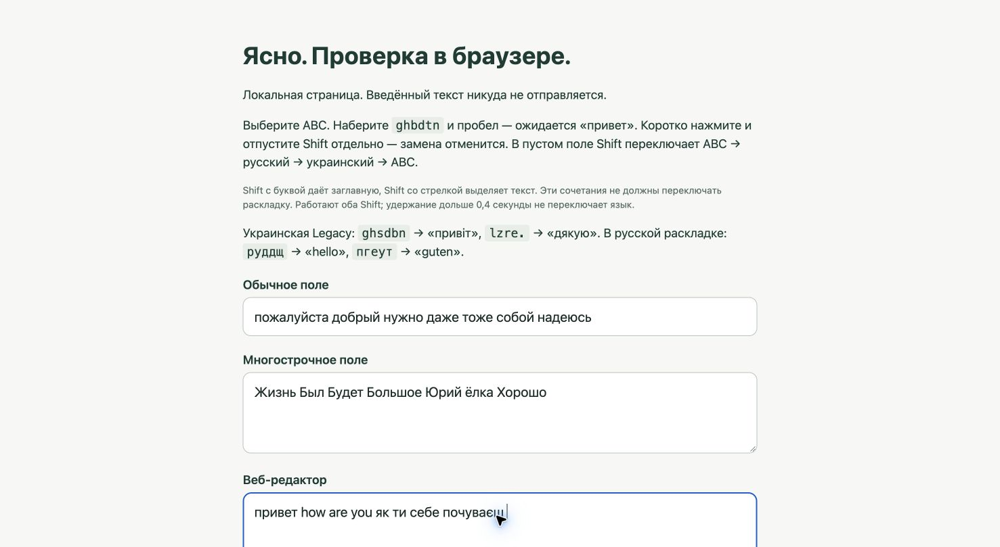

# Исправления после аудита Gemini — Ясно 0.1.4

17 октября 2026. macOS 27.0.1, Apple Silicon, Google Chrome.
Исходный [аудит](../AUDIT_REPORT.md) оставлен без изменений.

| Пункт аудита | Выполнено |
|---|---|
| 1. Исправление посреди слова | Автоматика запускается только по физическому пробелу. Пунктуация остаётся частью токена до завершения слова. |
| 2. Словари и редкие сокращения | Добавлены нативные списки принадлежности слов RU/UK, полученные проверкой частотных словоформ через словари LibreOffice/Hunspell с учётом словоизменения и имён. Никаких удалений по окончаниям. Редкий исходный вариант уступает частому целевому при сильном преимуществе; родной кириллический контекст защищает редкое слово. |
| 3. Numpad и пунктуация | Обратные таблицы предпочитают основной блок до Numpad. Ручное преобразование кириллического текста отдельно сохраняет пунктуацию, поэтому запятая не становится ни точкой Numpad, ни `^` основной клавиатуры. |
| 4. Ж/Б/Ю/ё | Неоднозначные символы больше не отбрасываются до проверки целевого слова. Регистр проверяется и после преобразования. Адреса, идентификаторы и аббревиатуры по-прежнему защищены. |
| 5. Уведомления, клики, граница | Выбранная приложением раскладка синхронизируется сразу. Позднее подтверждение не стирает новый токен. Проверяется левая граница слова. Клик отменяет подготовку; уже отправленный ввод завершается до выпуска клика. Ожидание проверяет актуальность, фокус и финальный курсор. |
| 6. Shift после пробела/новой строки | Завершённое правильное слово не преобразуется. Поиск не перескакивает на предыдущую строку. Отмена последней автозамены и явное выделение сохраняются. |
| 7. Пересоздание раскладок | Таблицы кэшируются; перестраиваются при изменении включённых источников или типа клавиатуры. Published-состояния обновляются только при изменении значения. |
| 8. Горячий путь перехватчика | ScrollWheel исключён. Текущие PID/раскладка синхронизируются наблюдателями и сверяются в начале слова, а не для каждой буквы. Сверка оставлена намеренно: системное уведомление может запоздать. |
| 9. Аллокации | Проверка алфавита вынесена на загрузку словарей; зарезервирована ёмкость, нижний регистр вычисляется один раз при поиске. Слова-исключения разбираются только при изменении настройки. |
| 10. Большие поля/UTF-16 | Fallback полного AXValue разрешён только при доступном числе символов до 16 384. Некорректная граница UTF-16/составного символа отвергается, а не расширяется. |
| 11. Автозапуск | Фоновый запуск определяется по Apple Launch Event. В готовом состоянии окно не открывается; явный запуск и открытие из меню показывают его. |

## Дополнительная ошибка, обнаруженная проверкой

В быстром contenteditable-прогоне выявлена перестановка букв при выпуске удержанных событий. Теперь следующий элемент очереди выпускается только после возврата предыдущего через перехватчик; новые физические нажатия ожидают своей очереди. Захваченным событиям назначается собственный CGEventSource: изменение одного поля userData на копии события другого процесса могло не менять фактическую метку.

Добавлена проверка доставки: при её сбое ввод освобождается, дальнейший перехват приостанавливается до перезапуска. Отладочная трассировка удалена, приложение не журналирует клавиши или текст.

## Проверено

`swift test`: **46 тестов, 0 ошибок**. Регрессии включают нативные RU/UK слова, русские слова при старом украинском предпочтении, редкие сокращения, заглавные буквы на символьных клавишах, ручную пунктуацию, границы слов/строк/эмодзи, исходную метку события, модификаторы и длительность Shift после перепривязки источника.

Системный драйвер работает только в собственной локальной вкладке Chrome; нажатия Enter и отправка форм отсутствуют. В стресс-проверке поле очищается стандартными Cmd+A/Backspace. Проверяется точный текст с нормализацией NBSP.

| Сценарий в установленной release-сборке | Результат |
|---|---|
| ABC `gj;`, пауза, затем остальные клавиши «пожалуйста» и пробел | До завершения остаётся `gj;` и ABC; затем `пожалуйста ` и Russian |
| Быстрый ввод «пожалуйста добрый нужно даже тоже собой надеюсь» | Полное совпадение, без пунктуации внутри слов |
| «Жизнь Был Будет Большое Юрий ёлка Хорошо» | Полное совпадение |
| 12 повторов `привет how are you як ти себе почуваєш ` в contenteditable | Все 12 совпали; интервал драйвера 15 мс между клавишами |
| К уже существующему `butto` дописано `ns ` | `buttons `, остаётся ABC |
| `привет\n`, затем два одиночных Shift | Предыдущая строка неизменна; Russian → Ukrainian → ABC |
| `Я использую ` и один Shift | Текст неизменен, меняется только раскладка |
| Выделение `привет, мир` и Shift | `ghbdtn, vbh`, запятая сохранена |
| ABC `dcb ` в Ukrainian Legacy | `всі ` и Ukrainian |
| «бил» при ошибочно выбранной Ukrainian Legacy | `был ` и Russian; Shift возвращает `бил ` и Ukrainian |

Пример аудита `dcs` соответствует Ukrainian-PC; в вашей Ukrainian Legacy для «всі» нужны физические клавиши `dcb`. Оба варианта проверены модульно; системно проверена включённая Legacy.

Сборка release и подпись установленного приложения проверены. Реальный выход/вход в macOS ради проверки автозапуска не выполнялся. Редкие сбои сторонних Accessibility-редакторов и все возможные гонки фокуса этим набором не исчерпываются; измерений энергопотребления не проводилось.

Источники языковых данных и лицензии: [ATTRIBUTION](../Sources/SwitchCore/Resources/ATTRIBUTION.md).
Распознавание фонового запуска: [Apple Launch Apple Event Constants](https://developer.apple.com/documentation/coreservices/1556410-launch_apple_event_constants).
