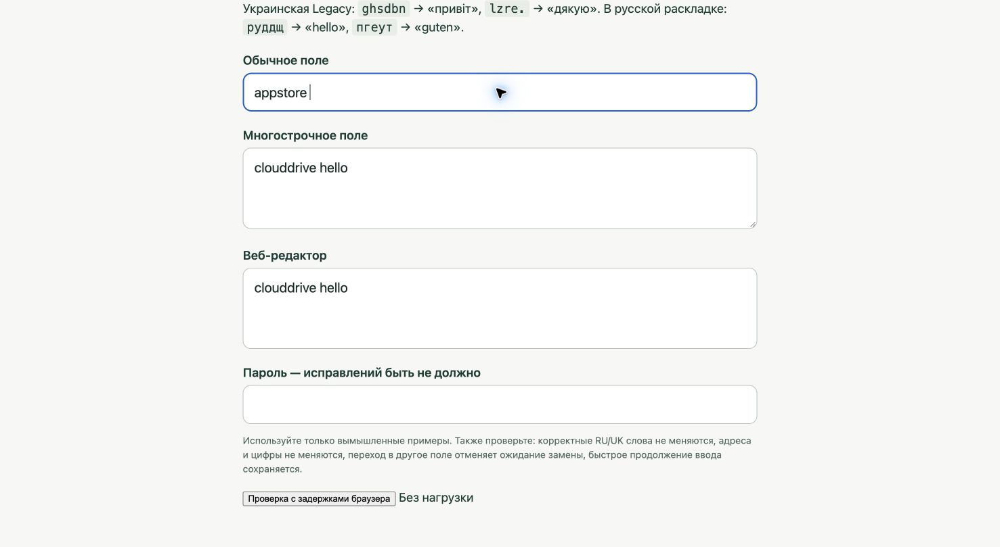

# Составные слова — Ясно 0.1.6

18 октября 2026.

## Причина

Автоматическое исправление требовало точного совпадения с частотным словарём.
`фззыещку` правильно преобразуется по физическим клавишам в `appstore`,
но такого целого слова нет ни в английском, ни в немецком списке.
В английском списке есть `app` (ранг 8494) и `store` (1034).
Поэтому предварительная проверка `maySuggest` и окончательная `suggest`
возвращали отсутствие замены. Ручное преобразование через Shift использует
другой путь и не требует присутствия слова в словаре.

## Изменение

Если точных словарных кандидатов нет и исходное кириллическое слово
тоже не распознано словарём, допускается латинское составное слово:

- Длина 7–32 ASCII-буквы, ровно две части по три буквы или больше.
- Обе части входят в первые 10 000 слов одного языка; хотя бы одна — в первые 2000.
- Нет рекурсивного разбиения на слоги, объединения английских и немецких частей
  или нового списка исключений для конкретных названий.
- Проверка работает только из кириллицы в латиницу. Словарные решения,
  выбор RU/UK, защита регистра, цифр, адресов и исключений сохраняются.
- Вывод не добавляется в словари, не используется как частотное свидетельство
  для соседних слов и не заменяет известное исходное слово.

Примеры: `appstore`, `playstore`, `dropbox`, `screenshot`, `smartwatch`,
`webstore`, `workflow`, `notepad`, `checklist`, `newsletter`, `clouddrive`.
Произвольное неизвестное название по-прежнему можно преобразовать вручную
коротким Shift; автоматическое угадывание любого набора букв не включено.

Приложение не обращается к сети или системной проверке орфографии во время
ввода. Проверка ограничена локальными словарями и длиной слова.

## Проверка

До изменения четыре новые регрессионные проверки дали 40 проваленных
утверждений, в том числе для самого `фззыещку` и предварительной проверки.
После изменения `swift test`: **57 тестов, 0 ошибок** (52 SwitchCore и 5 SwitchApp).
Проверены обе кириллические раскладки, регистр, пунктуация, исключение слова,
ручное преобразование, родные словоформы и отклонение случайных комбинаций.

Журналы автоматических проверок: `.build/compound-before.log` и
`.build/compound-after.log`. Они содержат только искусственные примеры.

В установленной 0.1.5 ошибка также воспроизведена системными нажатиями
в отдельной локальной вкладке Chrome: после пробела оставалось `фззыещку `.
После установки 0.1.6 получается `appstore `; короткий Shift возвращает
`фззыещку ` и Russian. Разрешения Accessibility и Input Monitoring сохранились.

В Chrome прошли **36 прогонов**: шесть составных слов из Russian и Ukrainian
в обычном поле, textarea и contenteditable. После пробела сразу вводилось
`hello ` с интервалом 8 мс между клавишами; результат каждого прогона
совпал полностью. Для contenteditable включалась нагрузка с задержками
180 мс на 20 секунд. Это проверка этих полей на данном Mac, а не гарантия
совместимости со всеми сайтами. Журналы: `.build/compound-chrome-*.log`.

