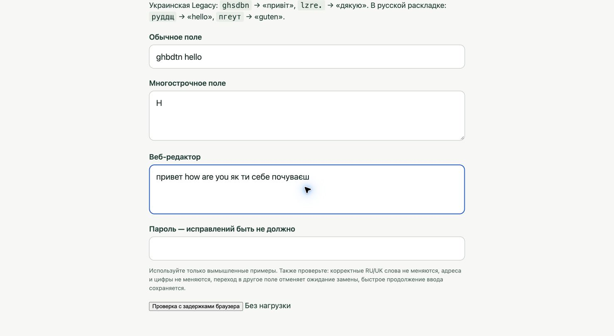

# Исправления ввода — Ясно 0.1.5

18 октября 2026. Автоисправление после пробела и ручное преобразование
«пробел → короткий Shift» поддерживаются одновременно.

## Подтверждённые причины

- Ручное преобразование после пробела намеренно пропускало слова, знакомые
  словарю, и отдельно отбрасывало неизвестные слова с нулевой оценкой.
  Эти ограничения удалены. Они продолжают действовать только там, где нужны
  для осторожной автоматики; явная команда Shift преобразует и правильное слово.
- Ручная операция резервировала ввод лишь после запуска фоновой задачи.
  Следующая клавиша могла раньше изменить ревизию и отменить команду.
  Теперь резервирование выполняется при обработке отпускания Shift.
- Отпускание предыдущего пробела между нажатием и отпусканием Shift
  ошибочно отменяло жест. Регрессионная проверка воспроизвела отсутствие
  ручной команды до исправления и проходит после него. Нажатие буквы
  при удерживаемом Shift по-прежнему отменяет жест и вводит заглавную.
- В веб-редакторе с искусственной задержкой 180 мс воспроизведён результат
  `hello я тут ` вместо `руддщ я тут `: раскладка сменилась, а слово осталось.
  AX-курсор ещё находился в старой позиции, и срабатывало переключение
  только языка. Для ручной команды теперь передаётся ограниченная подсказка
  о набранном слове и пробеле. Приложение ожидает подтверждения этого суффикса
  и не подменяет запрос преобразования простым переключением языка.
- Ожидание подтверждения пробела, выделения, замены и итогового курсора
  допускает задержку до 250 мс на каждом этапе и прекращается при изменении
  актуальности операции. Это не фиксированная задержка каждого исправления:
  как только состояние подтверждено, обработка продолжается.

## Защита нажатий

Буквальный пропуск «я»/«т» не воспроизвёлся в исходных быстрых прогонах.
В коде найден риск: event tap обслуживался главным потоком, на котором также
выполнялись синхронные запросы Accessibility при смене фокуса. Медленный
редактор мог задерживать обслуживание перехватчика.

Tap перенесён в отдельный поток. Его callback только копирует событие,
проверяет короткое состояние очереди под блокировкой и передаёт наблюдение
в основной поток без ожидания. В нём нет AX, TIS и запросов к приложениям.
Пробел и отпускание Shift резервируются до отложенной обработки, поэтому
входящие клавиши сохраняются, даже если основной поток занят. Заказчик
операции либо подтверждает редактирование, либо освобождает резерв.
Клик до фиксации замены отменяет подготовку и сохраняет порядок очереди.

Перед AX-редактированием проверяется наличие возможной словарной замены.
Обычные правильные слова, одиночные буквы, исключения и защищённые шаблоны
не запускают операцию редактирования. Никаких новых журналов ввода или
сетевых функций в приложение не добавлено.

## Проверка

`swift test`: **53 теста, 0 ошибок** — 48 тестов SwitchCore и 5 SwitchApp.
Новый тестовый стенд проходит настоящий обработчик очереди, но подменяет
доставку событий: он не нажимает клавиши в macOS. Проверены задержка
главного потока 350 мс, последовательные операции при выпуске очереди,
клик до обработки границы, Shift с немедленным продолжением ввода и
перекрытие Space-up/Shift.

Системный драйвер работает только в собственном локальном тестовом поле
Chrome. Реальные нажатия используются для ввода; начальная очистка поля
подтверждает Select All перед Backspace, чтобы задержка тестовой подготовки
не выдавалась за ошибку программы. Enter и отправка форм отсутствуют.

- Ручное преобразование после пробела проверено для `hello`, неизвестного
  `qzqxqz` и правильного русского `привет`, с немедленным продолжением ввода.
  Каждое второе нажатие Shift перекрывает отпускание пробела.
- В обычном поле прошли 18 повторов; в contenteditable с периодическими
  задержками по 180 мс также прошли 18 повторов после исправления.
- Смешанная фраза `привет how are you як ти себе почуваєш ` прошла 12 повторов.
- 25 повторов фразы с автозаменой `ghbdtn ` → `привет ` и последующим
  `я т я тут я там ты тут я там текст я тут ` прошли в textarea с нагрузкой.
  Следующая клавиша нажималась до отпускания предыдущей; текст совпал целиком.
- Отмена автозамены одним Shift, заглавная `H` с обоими Shift и выделение
  Shift+стрелка прошли системную проверку; обычные сочетания не сменили язык.

Это проверка на данном Mac и Chrome, а не гарантия для всех веб-редакторов.
Если редактор не предоставляет подтверждённый диапазон или не отвечает
в допустимое время, операция пропускается. Браузерная проверка до исправления
и итоговые журналы находятся в `.build`. Журналы этих прогонов содержат
только искусственные тестовые фразы.

На снимке: первое поле после ручного преобразования «привет » и дописывания
`hello`, второе — заглавная `H`, последнее — проверенная смешанная фраза.

